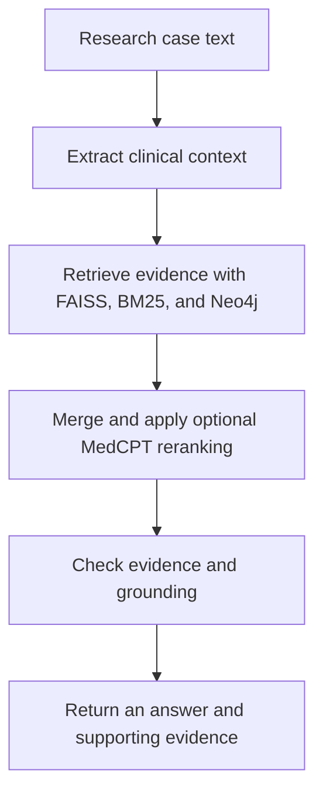

# MedRAG · Evidence Retrieval for Clinical Research

MedRAG is a graduation research prototype that explores how dense retrieval, lexical search, and a clinical knowledge graph can support evidence-grounded answers to stroke-related research questions. An accompanying Streamlit interface exposes the retrieval workflow and a separate structured risk-model experiment.

**Research and education only.** The system has no verified clinical accuracy or clinical validation. Use synthetic research cases for demonstration.

## Start here

The repository contains two source layouts. Use the organized [medical-diagnose-assistant](medical-diagnose-assistant) subdirectory for setup and experimentation. The root also retains earlier scripts from the project.

- [Application README](medical-diagnose-assistant/README.md) describes the component layout, configuration, and available code paths.
- [Setup and required artifacts](medical-diagnose-assistant/docs/SETUP.md) explains corpus preparation, indexes, Neo4j, and optional model backends.
- [Technical design](medical-diagnose-assistant/docs/TECHNICAL_DESIGN.md) and [validation notes](medical-diagnose-assistant/docs/CLEANUP.md) document the implementation and its verification limits.

## Architecture



| Component | Role |
| --- | --- |
| FAISS and BM25 | Find semantically and lexically relevant passages. |
| Neo4j | Retrieve related clinical entities and graph evidence. |
| MedCPT | Rerank passages using a biomedical cross-encoder when available. |
| Evidence judge and rules | Assess the supporting evidence and expose reasoning signals. |
| Optional language model | Generate or refine output according to the configured backend. |
| Structured risk experiment | Evaluate a separate bundled serialized Random Forest pipeline on structured inputs. Its score has no verified clinical calibration. |

## Set up the research environment

Run the following from the repository root in PowerShell. Use a separate Python 3.10+ environment.

```powershell
Set-Location medical-diagnose-assistant
python -m venv .venv
.\.venv\Scripts\python.exe -m pip install -r requirements.txt
Copy-Item .env.example .env
```

Before launching, follow the [setup guide](medical-diagnose-assistant/docs/SETUP.md) to supply the local corpus, build retrieval indexes, configure Neo4j, and install the components required by your selected model backend. Then run:

```powershell
.\.venv\Scripts\python.exe -m streamlit run app_streamlit.py
```

Review retrieved passages, document identifiers where available, reranking signals, and the explanation alongside a synthetic case.

## Reproducibility and scope

- The original archive lacks the medical corpus, generated retrieval indexes, Neo4j database, and risk-model training code.
- Existing dependency files document direct requirements. The original scikit-learn environment for the serialized risk model is unavailable.
- Full application execution and clinical performance have not been independently verified. Any external generation backend may receive supplied text according to its configuration.
- The [academic reports](medical-diagnose-assistant/docs/reports) are retained as project records.

## ملخص بالعربية

مشروع بحثي يدرس استخدام الاسترجاع الهجين والرسم البياني المعرفي في الإجابة عن أسئلة بحثية متعلقة بالسكتة الدماغية. يجمع بين فهرسة المستندات وإعادة ترتيب الأدلة وعرض المصادر في واجهة محلية. يتطلب التشغيل الكامل تجهيز المصادر والفهارس وقاعدة الرسم البياني. المشروع مخصص للبحث والتعليم.
