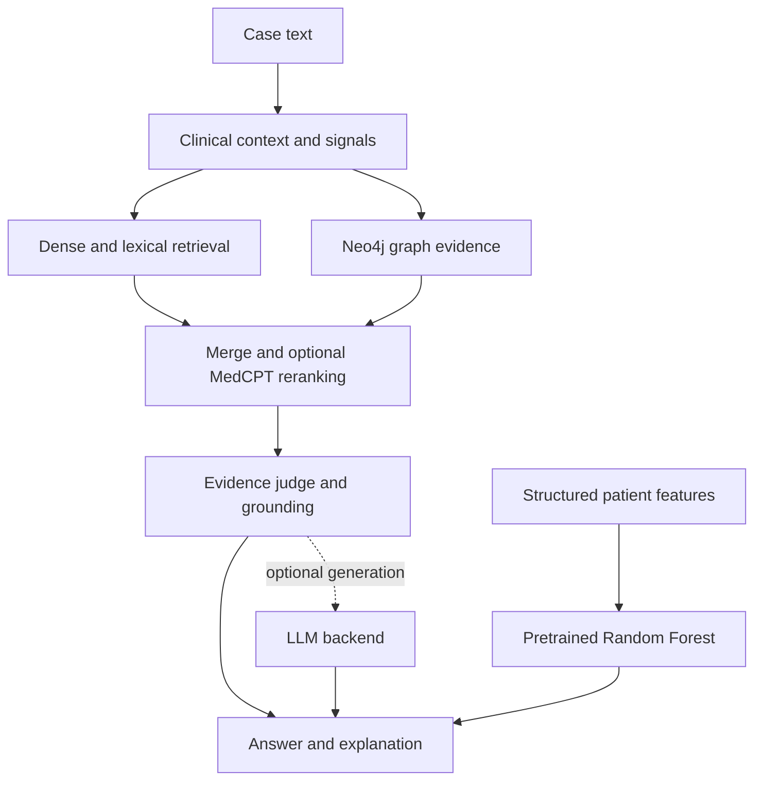

# Med-RAG — Medical Diagnosis Assistant

**Hybrid retrieval · Knowledge graphs · Evidence grounding · Stroke-focused research · Streamlit**

A research prototype for exploring medical questions with document retrieval, a Neo4j knowledge graph, clinical context analysis, and evidence-based answer selection. The source combines FAISS dense retrieval, BM25 lexical search, MedCPT reranking, and an optional language-model layer. A separate pretrained Random Forest pipeline estimates a stroke-risk score from structured features.

> **Status:** Source reorganized for GitHub. The original archive does not contain the medical corpus, retrieval indexes, Neo4j database, or training code. Full application execution and clinical performance have **not** been independently verified. Research and education only; not for medical decisions.

## At a glance

| Area | Implementation in this repository |
| --- | --- |
| Interface | Streamlit: case questions and structured risk prediction |
| Retrieval | FAISS HNSW, BM25, graph-derived evidence |
| Embeddings | Configured as `ncbi/MedCPT-Article-Encoder` |
| Reranking | `ncbi/MedCPT-Cross-Encoder` |
| Graph | Neo4j via py2neo; spaCy/scispaCy entity processing |
| Reasoning | Clinical context/signals, agent controller, evidence judge, explanations |
| Generation | Hugging Face API by default; optional OpenAI-compatible and local backends |
| Risk model | Bundled serialized pipeline; experimental threshold of 0.05 |
| Evaluation | No reproducible benchmark or verified clinical accuracy supplied |

## Processing flow



The diagram summarizes available code paths. Configuration, optional dependencies, and available artifacts determine which paths run; it does not imply validated diagnostic performance.

## Repository layout

```text
medical-diagnose-assistant/
├── app/
│   ├── rag/                 # Retrieval, graph, evidence and context modules
│   ├── models/              # LLM, reranker and risk-model adapters
│   ├── kb/chunks/           # Local corpus chunks (not supplied)
│   └── index/               # Generated FAISS/BM25 indexes (not supplied)
├── data/pubmed_subset/      # Local input JSONL (not supplied)
├── models/
│   └── stroke_rf_pipeline.joblib
├── docs/
│   ├── TECHNICAL_DESIGN.md
│   ├── SETUP.md
│   ├── CLEANUP.md
│   ├── cleanup-manifest.json
│   └── reports/             # Both original PDF reports, preserved
├── app_streamlit.py
├── config.yaml
├── requirements.txt
├── requirements-optional.txt
└── .env.example
```

## Setup and run

Use a separate Python 3.10+ environment. Dependencies are a direct-import inventory, **not a tested version lock**. The pretrained pickle/joblib artifact may require the original scikit-learn version, which was not recorded in the archive.

```powershell
python -m venv .venv
.venv\Scripts\Activate.ps1
python -m pip install -r requirements.txt
Copy-Item .env.example .env
```

Before launching, follow [Setup and required artifacts](docs/SETUP.md) to supply the corpus, build indexes, install the scientific NLP model, configure Neo4j, and choose an LLM backend. Run all commands from the repository root:

```powershell
python -m streamlit run app_streamlit.py
```

Inspect a case through Python after setup:

```python
from app.rag.pipeline import get_answer

result = get_answer("Example research case text", top_k=3)
print(result)
```

## Scope and limitations

- Stroke and neurological patterns receive particular attention in the source; this is not evidence of clinical validity.
- Missing corpus/indexes/database prevent reproducing the complete system from this ZIP alone.
- No training dataset, training script, calibration study, or model environment accompanies the bundled risk model. Its numeric output must not be treated as a calibrated clinical probability.
- An optional `clinical_subtype_resolver` import has a fallback; that module was absent from the original archive and has not been fabricated.
- Arabic-oriented prompts and multilingual text handling exist, but cross-language retrieval quality has not been measured.
- Model downloads, provider access, GPU availability, and dependency compatibility affect execution. API-backed generation may send supplied text to the selected provider.

Read [Technical design](docs/TECHNICAL_DESIGN.md) and [Cleanup and validation](docs/CLEANUP.md) for implementation details and exactly what was checked. Original academic PDFs are retained under [reports](docs/reports/); their claims have not been independently verified.

## Attribution and licensing

This repository retains the supplied source and reports. No license or authoritative dataset/model provenance was included in the archive; this cleanup does not assign a license or grant redistribution rights. Review the terms of any corpus, pretrained model, and external service before publishing or reuse.
